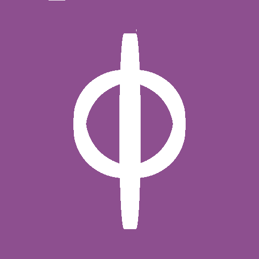

  
  <h1>Ribbon (Beta)</h1>
  
<strong>基于 Embeddium 21.1 分支的 Minecraft 1.21.1 NeoForge 客户端增强模组</strong>

  
A client-side performance and QoL enhancement mod for Minecraft 1.21.1 NeoForge, forked from Embeddium 21.1.

  
  
  

---

## 📖 简介 (Introduction)

**Ribbon** 是一个客户端增强模组。它不仅继承了 Embeddium 强大的渲染优化，还加入了一整套“让游戏更好看、更好玩”的功能：从彩虹准星到内置 MP3 播放器，从伤害数字到农历显示。所有功能都可以在设置里单独开关，互不干扰，且与 **Iris 光影**、**Monocle**、**Distant Horizons (DH)** 完美兼容。

**Ribbon** is a client-side enhancement mod. It retains Embeddium's powerful performance optimizations (chunk rendering, entity culling, particle culling) while adding a full suite of visual, audio, and HUD improvements. All features are toggleable in the settings and are fully compatible with Iris, Monocle, and Distant Horizons.

---

## ✨ 核心功能 (Features)

- 🎵 **内置 MP3 播放器**：无外部依赖，将 `.mp3` 放入 `.minecraft/ribbon_music/` 即可。快捷键：`P` 打开 UI，`K` 播放/暂停，`,` / `.` 切歌。
- 📊 **全套 HUD 系统**：FPS/TPS 悬浮窗、光照等级、农历与节日显示（支持四角定位与缩放）。
- 🎯 **视觉增强**：彩虹准星、彩虹方块描边、彩虹生命值、物品栏高亮。
- 💥 **特效与粒子**：高达 21 种点击特效、命中伤害数字、生物群系 RPG 标题。
- ⚡ **性能优化**：实体、粒子、方块、掉落物剔除，动态光源（目前仅影响实体与粒子）。
- 🌐 **双语支持**：设置界面支持中英文实时切换，无需重启游戏。

---

## ⚠️ 重要须知 (Important Notes)

- **环境要求**：Minecraft 1.21.1, NeoForge 21.1.259, Java 21。
- **请勿安装 Embeddium 或 Sodium**：Ribbon 已内置其分支，同时安装会导致崩溃。
- **🚨 绝对不要安装 Radium**：Radium 会导致 `TrialSpawner` 多线程竞态崩溃。请使用官方 Lithium NeoForge 版本。
- **待开发功能**：FSR 1.0 超分辨率（EASU + RCAS）正在开发中。`FAST_MAP_ENABLED` 目前仅有开关无实际功能。

---

## 📦 安装 (Installation)

1. 安装 Minecraft 1.21.1 和 NeoForge 21.1.259。
2. 从 [发布](https://github.com/follish0s/ribbon-21.1-neoforge/releases) 页面下载最新的 `.jar` 文件。
3. 将 `.jar` 文件放入 `.minecraft/mods` 文件夹中。
4. 启动游戏，在视频设置的 Ribbon 页面中进行配置。

---

## 📜 协议与致谢 (License & Credits)

本项目基于 embeddedt 的 **Embeddium** 开源项目分支开发，遵循 **LGPL-3.0-or-later** 协议。
This project is a fork of Embeddium by embeddedt, distributed under the **LGPL-3.0-or-later License**.

### 致谢 (Credits)
- **embeddedt** & **FiniteReality**：Embeddium 的开发者。
- **JellySquid** & **CaffeineMC**：Sodium 的最初开发者（Ribbon 不归 CaffeineMC 支持）。
- **Asek3**：最初的 Forge 移植者。
- 所有为 Ribbon 提供测试与反馈的玩家。
